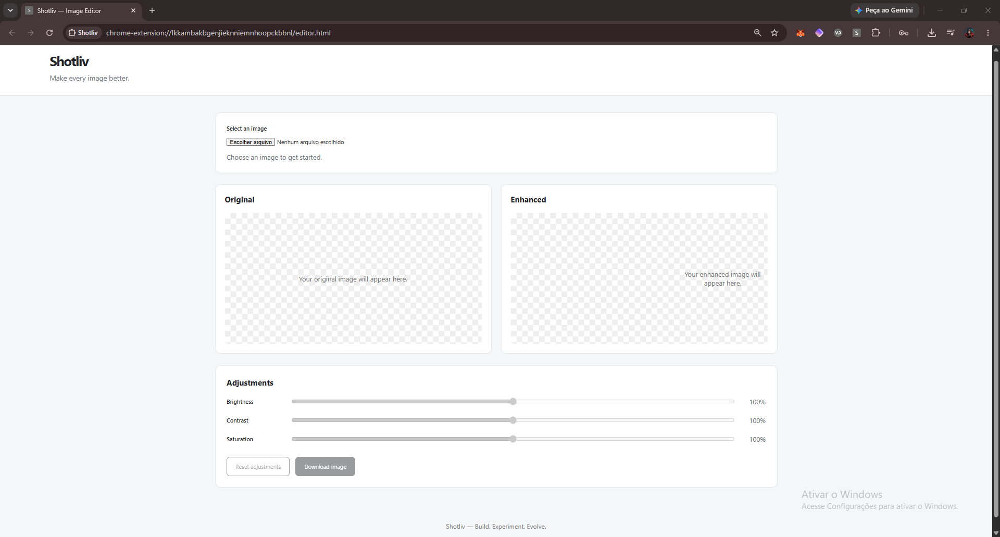
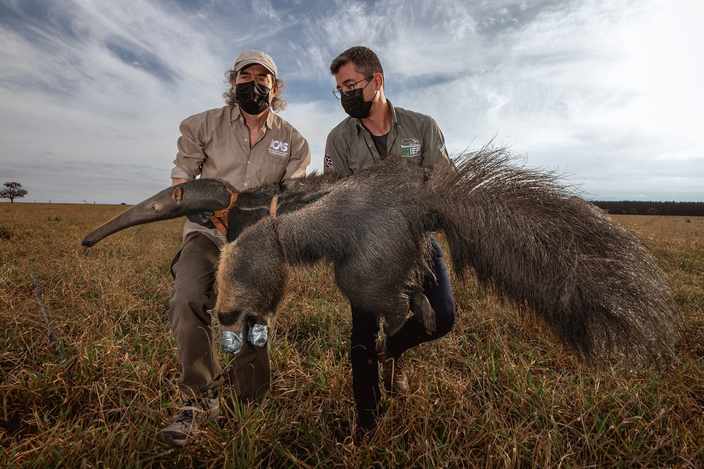
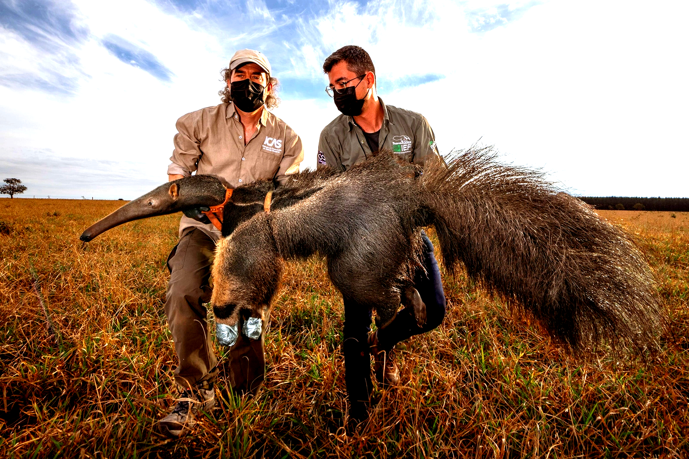
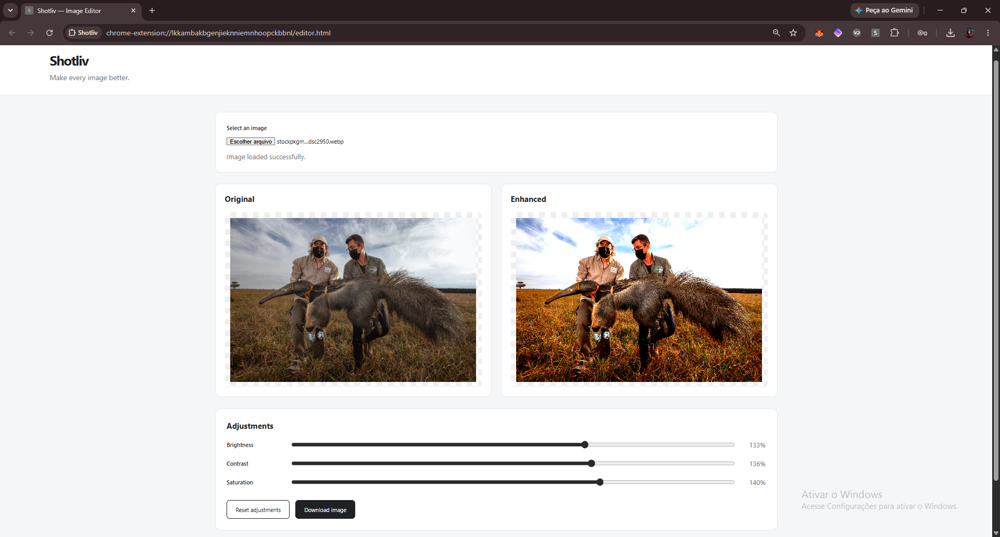

# Shotliv

**Image enhancement powered by intelligent processing, built in public.**

Shotliv is a lightweight Chrome extension for enhancing images directly in the browser.

Users can adjust brightness, contrast, and saturation, compare the original and enhanced images, and export results in PNG, WebP, or JPEG formats.

All image processing happens locally in the browser. No account, image upload, or cloud processing is required.

The project follows a **Chrome extension first** approach, with the possibility of expanding into a SaaS platform as real user needs are validated.

## Project direction

- Start with a lightweight browser-based experience.
- Focus on useful image enhancement capabilities.
- Keep the product simple and easy to use.
- Evolve based on feedback, experimentation, and validated needs.

## MVP Preview

The initial MVP allows users to load images, adjust visual properties, compare results, and download enhanced images directly in the browser.

| Editor | Original image |
|---|---|
|  |  |

| Enhanced image | Editing adjustments |
|---|---|
|  |  |

## Development

Shotliv is being built in public. This repository is the home for its source code, documentation, and development progress.

The project is in its early stages. Features, technical decisions, and priorities may change as ideas are tested and real user feedback is collected.

## Follow the journey

Watch this repository to follow development, track changes, and contribute feedback.

---

**Build. Experiment. Evolve.**
